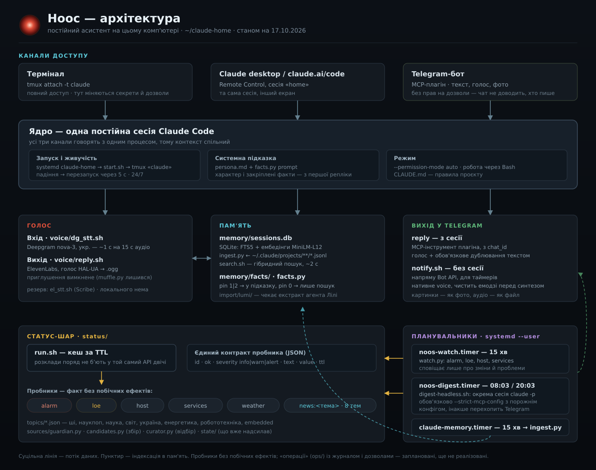

# Noos

An always-on personal assistant built on [Claude Code](https://claude.com/claude-code).
One long-running session on a home server, reachable from a terminal, the Claude
desktop app, and Telegram — with voice, a searchable memory of every past
conversation, scheduled digests, and a task list that plans itself into Google Calendar.

Built for one person, in Ukrainian. Published as a working example of what a
persistent Claude Code session can be turned into; the code is MIT, the personal
data never leaves the machine.



## What it does

**Status probes** — small scripts with a uniform JSON contract (`id`, `severity`,
`value`, `text`, `ttl`), run through a TTL cache:

| Probe | Source |
|---|---|
| `loe` | power-outage schedule for the local grid queue |
| `alarm` | air-raid alerts by region and district |
| `weather` | wttr.in |
| `host` / `services` | disk, RAM, load, temperature, systemd units, containers |
| `news` | eight topic feeds (Guardian API + Google News) |
| `mail` | new Gmail since last check — IMAP, headers only, nothing marked read |
| `cal` | calendar events via a secret iCal URL, RRULE expanded |
| `tasks` | overdue / today / this week |
| `changes` | what the assistant itself changed today |

**A watcher** runs every 15 minutes and stays silent unless something actually
changed — alerts repeat at most once every three hours, warnings only on a new
signature, recoveries are reported once.

**Digests** at 08:03 and 20:03 are produced by a separate headless `claude -p`
session that reads the probes, picks at most two news items per topic, ranks them
down to four, and sends the result to Telegram as text plus a synthesized voice
message.

**Memory** — every transcript under `~/.claude/projects/**/*.jsonl` is indexed
into SQLite (FTS5 + multilingual MiniLM embeddings) and searched with reciprocal
rank fusion, so "what did we decide about X" has an answer instead of an apology.
Short pinned facts live in their own store and are injected into the system prompt
at session start.

**Tasks and planning** — an append-only event log (`add` / `done` / `defer` /
`block` / `link`), projected into current state. A task carries a deadline or a
period ("this weekend", "next week"), and separately a flag for whether it deserves
a block of time. Tasks with a block get calendar events; tasks with only a date get
all-day `☐` entries; closed ones turn into `☑`. One task can own several events.

**Voice** — ElevenLabs for synthesis, Deepgram `nova-3` for recognition, Opus/ogg
for Telegram. Every voice reply is duplicated as text, and the recognized text is
quoted back so a misheard word can be corrected.

**Change log** — a `PostToolUse` hook records every mutating tool call to an
append-only JSONL file (`chattr +a`), and a nightly summary reports what changed.

## Layout

```
CLAUDE.md          project instructions, loaded on every session start
persona.md         character and tone, passed via --append-system-prompt
start.sh           session launcher; builds the prompt from persona + pinned facts
notify.sh          direct Telegram Bot API sender (text and voice), session-free
status/            probes, watcher, digest pipeline, news topics
memory/            transcript index (FTS5 + embeddings), pinned facts, search
tasks/             event-sourced task store, calendar config
voice/             synthesis, recognition, ogg conversion
changelog/         append-only log of the assistant's own changes
telegram/          bot command menu registration
```

## Running it

Requires Claude Code, Python 3.10+, and a Telegram bot token. Nothing else is
mandatory — every integration degrades to a clear "no keys" message instead of
failing.

```bash
git clone <this repo> ~/claude-home
cd ~/claude-home
virtualenv .venv-voice && .venv-voice/bin/pip install python-dateutil

cp .env.gmail.example .env.gmail         # optional: mail probe
cp .env.calendar.example .env.calendar   # optional: calendar probe
cp tasks/config.example.json tasks/config.json
chmod 600 .env.* tasks/config.json

./start.sh                                # or run it under systemd/tmux
```

Keys live in `.env.*` files with mode `600` and are never committed. Personal data
— the conversation index, pinned facts, tasks, the change log, probe caches — is
git-ignored by design; see `.gitignore` for the full list.

Scheduling is plain systemd user timers:

```
noos-watch.timer      every 15 min   silent unless something changed
noos-digest.timer     08:03, 20:03   full digest, text + voice
noos-changes.timer    23:30          what changed today
claude-memory.timer   every 15 min   incremental transcript indexing
```

## Notes for anyone adapting it

- Headless runs must disable the Telegram plugin specifically, not MCP as a whole:
  two sessions polling `getUpdates` steal each other's messages, but stripping all
  MCP also removes the Gmail and Calendar connectors the digest needs.
- Deepgram `nova-2` mangles Ukrainian proper nouns; `nova-3` does not.
- A probe file must not be named after a stdlib module — `calendar.py` shadows
  `calendar` and breaks `urllib`. It is called `cal.py` for that reason.
- In `.gitignore`, a comment on the same line as a pattern becomes part of the
  pattern, and the rule silently stops working.

## License

MIT — see [LICENSE](LICENSE).
